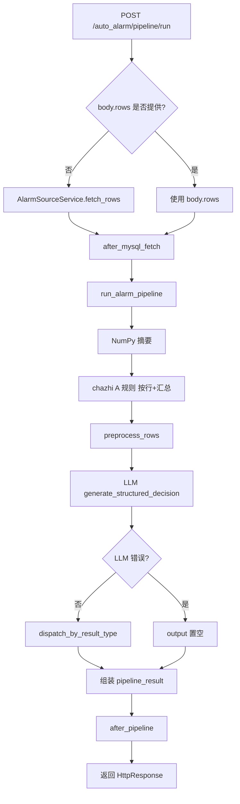

# auto_alarm 执行框架说明

本文档描述 `ric-train-master` 下 **auto_alarm** 子模块的数据流、分层职责、HTTP 操作方式与环境配置。实现代码位于目录 `auto_alarm/`。

---

## 1. 总体架构（分层）

| 层级 | 路径（示例） | 职责 |
|------|----------------|------|
| **API** | `auto_alarm/api/alarm_api.py` | FastAPI 路由：参数校验、`HttpResponse` 封装、调用 Service / Pipeline |
| **Core** | `auto_alarm/core/pipeline.py` | 流水线编排：NumPy → chazhi 规则 → LLM → 输出分发 → 后置动作总线 |
| **Service** | `auto_alarm/service/` | 业务服务：MySQL 拉数编排、NumPy 摘要、LLM 调用、表单规范化 |
| **Repository** | `auto_alarm/repository/` | 数据访问：按配置执行 SQL，连接由工厂合并 `AUTO_ALARM_DB_*` 与全局 `DB_*` |
| **Business** | `auto_alarm/business/` | 领域规则：如 `chazhi_0_*` 列「括号内负数」触发 A 流程 JSON |
| **Output** | `auto_alarm/output/` | 按大模型 `result_type` 分发到不同处理模块（当前多为占位） |
| **Actions** | `auto_alarm/actions/` | 拉数后 / 流水线结束后的扩展钩子（默认可空实现，可 `register_*` 挂载） |

路由注册：`main.py` 调用 `auto_alarm.router.router.init_router(app)`，统一前缀 **`/auto_alarm`**。

---

## 2. 执行逻辑（主流程）

### 2.1 完整流水线（推荐入口）

**接口：** `POST /auto_alarm/pipeline/run`  

**逻辑顺序：**

1. **取数**
   - 若请求体 **未传** `rows`：通过 `AlarmSourceService` → `AlarmSourceRepository` 从 **MySQL** 拉取（见第 4 节配置）。
   - 若请求体 **传入** `rows`：跳过 MySQL，直接使用 JSON 行（联调/测试）。
2. **后置钩子（拉数后）**  
   `get_post_action_bus().after_mysql_fetch(rows, meta)`，`meta` 含 `source`：`mysql` 或 `inline_json`。
3. **流水线 `run_alarm_pipeline(rows, …)`**（`core/pipeline.py`）  
   - **NumPy**：`process_table_rows_numpy(rows)` → 形状、列类型推断、数值列统计、预览行。  
   - **日志**：`log_numpy_process_result(..., source=..., detail=...)`。  
   - **chazhi 规则**：`evaluate_business_process_a(rows)` → 每行 + 整表汇总 A 流程 JSON 条件。  
   - **预处理**：`preprocess_rows(rows)`（当前透传，可扩展）。  
   - **大模型**：`generate_structured_decision(processed_rows, extra_instruction)` → 结构化 JSON（含 `result_type` 等）。  
   - **输出分发**：`dispatch_by_result_type(parsed)` → `notify` / `report` / `escalate` / `ignore` 等 Handler。  
   - **后置钩子（流水线结束）**  
     `get_post_action_bus().after_pipeline({ pipeline_result, source_rows, processed_rows })`（成功/失败都会调用，错误信息在 `pipeline_result.error`）。

### 2.2 仅查库 + 分析（不调大模型）

**接口：** `POST /auto_alarm/mysql/fetch`  

**逻辑：** `AlarmFetchService.fetch_from_mysql(limit)`  

1. `AlarmSourceService.fetch_rows` → MySQL  
2. `process_table_rows_numpy` + 日志  
3. `evaluate_business_process_a`  
4. `after_mysql_fetch`  
5. 返回 `rows`、`numpy_process`、chazhi 相关字段（无 `llm_raw` / `parsed`）。

### 2.3 仅 JSON 行跑流水线

**接口：** `POST /auto_alarm/pipeline/run-rows`  

**逻辑：** 与 `pipeline/run` 在「有 `rows`」时等价，但不走 MySQL 分支；`numpy_log_source` 固定为 `inline_json`。

---

## 3. 流程图（Mermaid）



---

## 4. 配置与操作方法（.env）

配置类：`Base.Config.setting` → `settings.auto_alarm_db`、`settings.auto_alarm`。

### 4.1 MySQL 连接

- **全局默认**：`DB_HOST`、`DB_PORT`、`DB_USER`、`DB_PASSWORD`、`DB_NAME`、`DB_CHARSET`（与项目其它模块一致）。
- **auto_alarm 专用覆盖**（任选，不填则用全局）：
  - `AUTO_ALARM_DB_HOST`
  - `AUTO_ALARM_DB_PORT`
  - `AUTO_ALARM_DB_USER`
  - `AUTO_ALARM_DB_PASSWORD`
  - `AUTO_ALARM_DB_NAME`
  - `AUTO_ALARM_DB_CHARSET`

连接构建：`auto_alarm/repository/mysql_client_factory.py` → `get_auto_alarm_mysql_client()` → `Base.Client.mysqlClient.MySQLClient`。

### 4.2 数据源 SQL

二选一（代码见 `AlarmSourceRepository.fetch_rows`）：

| 环境变量 | 说明 |
|----------|------|
| **`AUTO_ALARM_FETCH_SQL`** | 非空时：整段 SQL **原样执行**（需自行控制行数、条件等）。 |
| **`AUTO_ALARM_SOURCE_TABLE`** | 未配置 `FETCH_SQL` 时使用；表名仅允许 `[A-Za-z0-9_]`。默认表名 `auto_alarm_source`。 |
| **`AUTO_ALARM_FETCH_LIMIT`** | 仅「按表查询」模式：`SELECT * FROM \`表\` LIMIT ?` 的参数；默认 `10000`。 |

接口 `MysqlFetchOnlyRequest` / `AlarmPipelineRunRequest` 中的 **`limit`** 可覆盖默认 `fetch_limit`（仅表模式；自定义 SQL 模式忽略 limit 拼接）。

---

## 5. HTTP 请求说明

基础 URL 示例：`http://127.0.0.1:8000`（以你本地 `uvicorn` 为准）。

### 5.1 `POST /auto_alarm/mysql/fetch`

**作用：** 只读 MySQL + NumPy + chazhi，不调用大模型。

**Body（JSON）：**

```json
{
  "limit": 500
}
```

`limit` 可选；不传则用 `AUTO_ALARM_FETCH_LIMIT`。

### 5.2 `POST /auto_alarm/pipeline/run`

**作用：** 主流程（默认 MySQL → 全流程）。

**Body（JSON）：**

```json
{
  "rows": null,
  "limit": null,
  "extra_instruction": "可选，给模型的补充说明"
}
```

- `rows`：非空数组时 **不查库**，直接作为数据源。  
- `limit`：仅在不传 `rows` 时生效（表查询模式）。

### 5.3 `POST /auto_alarm/pipeline/run-rows`

**作用：** 仅用 body 中的 `rows` 跑流水线。

**Body（JSON）：**

```json
{
  "rows": [ { "col1": "v1" } ],
  "extra_instruction": null
}
```

### 5.4 响应形态

项目使用自定义 `HttpResponse`（`status_code`、`data`、`msg`）。成功时 `data` 中常见字段包括：

- `numpy_process`：NumPy 摘要  
- `chazhi_process_a_triggered`、`business_process_a`、`chazhi_per_row`  
- `llm_raw`、`parsed`、`output_module`、`output_result`（完整流水线）  
- `error`：流水线内部错误信息字符串（若存在）

---

## 6. 扩展点（后续实现）

| 扩展点 | 位置 | 操作方式 |
|--------|------|----------|
| 拉数后动作 | `auto_alarm/actions/post_pipeline_actions.py` | 实现 `AfterMysqlFetchAction`，`get_post_action_bus().register_after_fetch(obj)` |
| 流水线结束后动作 | 同上 | 实现 `AfterPipelineAction`，`register_after_pipeline(obj)` |
| LLM 提示词 | `auto_alarm/prompt/alarm_prompt.py` | 修改 `AUTO_ALARM_SYSTEM` / `build_user_message` |
| chazhi / A 流程规则 | `auto_alarm/business/chazhi_process_a.py` | 改列名、解析正则、汇总结构 |
| 输出模块 | `auto_alarm/output/handlers/*.py` + `dispatcher.py` | 实现 `handle`，并在 `register_default_handlers` 中注册类型 |
| 预处理 | `auto_alarm/core/pipeline.py` → `preprocess_rows` | 行级清洗、补字段等 |

---

## 7. 本地运行（操作步骤）

1. 配置项目根目录 `.env`：`DB_*`、可选 `AUTO_ALARM_*`、大模型相关（如 `DASHSCOPE_API_KEY` 等，与 `Base` 一致）。  
2. 安装依赖并启动（示例）：

```bash
cd ric-train-master
python -m venv venv
venv\Scripts\activate
pip install -r requirements.txt
uvicorn main:app --host 0.0.0.0 --port 8000 --reload
```

3. 浏览器打开 **`http://127.0.0.1:8000/docs`**，在 **AutoAlarm** 分组下调试上述接口。

---

## 8. 关键文件索引

| 文件 | 说明 |
|------|------|
| `auto_alarm/api/alarm_api.py` | 路由与入参 |
| `auto_alarm/core/pipeline.py` | 流水线主逻辑 |
| `auto_alarm/service/alarm_source_service.py` | MySQL 拉数入口（Service） |
| `auto_alarm/service/alarm_fetch_service.py` | 查库+分析编排 |
| `auto_alarm/service/table_numpy_service.py` | NumPy 矩阵与统计 |
| `auto_alarm/service/llm_service.py` | 大模型调用与 JSON 解析 |
| `auto_alarm/repository/alarm_source_repository.py` | SQL 执行 |
| `auto_alarm/business/chazhi_process_a.py` | A 流程规则 |
| `auto_alarm/output/dispatcher.py` | 按 `result_type` 分发 |
| `auto_alarm/model/schemas.py` | Pydantic 请求体 |

---

*文档与当前代码版本同步；若你改了路由或配置类名，请以代码为准并更新本 MD。*
