# LSTA 模块架构与接口调用链

**范围说明：** 下文「每个文件」指 `LSTA/` 包内源码与文档；接口全部为 LSTA 暴露的 FastAPI 路由。仓库根目录的 `main.py`、`LDA/`、`LMA/`、`Base/`、`admin/` 仅在跨包调用处标注，不展开全仓文件树。

本文说明 `LSTA/` 目录下各文件的职责、模块间依赖关系，以及**每次请求 HTTP 接口时**代码在文件之间的跳转顺序（以「入口 → 业务 → 外部依赖」为主链）。

---

## 1. 服务如何被挂载到 HTTP

| 层级 | 文件 | 作用 |
|------|------|------|
| 主应用（可选） | 仓库根目录 `main.py` | 聚合多个子应用路由；其中 `init_listing_router(app)` 把 LSTA 挂到同一 FastAPI 实例。 |
| LSTA 独立入口（可选） | `LSTA/main.py` | 仅启动 LSTA 子服务（端口默认 8003），同样调用 `init_router`。 |
| 路由注册 | `LSTA/router/router.py` | `app.include_router(listing_router, prefix="/lsta", tags=["LSTA"])`。 |
| 接口实现 | `LSTA/api/listingApi.py` | 定义全部 `APIRouter` 路由与处理函数。 |

**因此：** 在根 `main.py` 启动时，所有 Listing 相关接口的 URL 前缀为 **`/lsta`**，例如 `POST /lsta/optimize`。

---

## 2. `LSTA/` 目录文件一览

| 路径 | 职责摘要 |
|------|-----------|
| `main.py` | 独立运行 LSTA 的 FastAPI 应用入口；启动时触发 `model_pool.run_full_test_async()`。 |
| `constants.py` | ABA/SQR 数据库连接、抓取超时、代理、市场域等环境相关常量。 |
| `router/router.py` | 将 `listingApi` 的 router 挂到 `/lsta`。 |
| `api/listingApi.py` | **HTTP 边界**：校验请求、编排 service/core、写 `llm_memory`、返回响应模型。 |
| `core/listingCore.py` | **Listing 引擎**：`fetch` / `optimize` / `optimize_multi` / `analyze` / `evaluate` / `refine`、流量词 LLM 分析等；调用 `amazon_service`、`model_pool`、`listingPrompt`。 |
| `models/listingState.py` | Pydantic 请求/响应与领域数据结构（`ProductData`、`OptimizedListing` 等）。 |
| `prompt/listingPrompt.py` | 各场景系统/用户提示词模板与拼装函数。 |
| `service/base.py` | 统一 `service_logger`。 |
| `service/amazonService.py` | SP-API 或代理抓取 Amazon 详情与评论 → 组装 `ProductData`。 |
| `service/trafficWordService.py` | 查 ABA/SQR MySQL，判断词是否为流量词。 |
| `service/triDimSqlService.py` | **纯函数**：生成三维诊断用 Doris SQL（无 DB 连接）。 |
| `service/productDimService.py` | 从 `leang_product_info`（LDA 库配置）查颜色等维度。 |
| `service/sqrSearchVolumeService.py` | SQR 表聚合搜索量 + 进程内缓存。 |
| `service/searchTermRecommendService.py` | ASIN → MySQL + 共享目录 Excel → 搜索词相关性。 |
| `service/reviewAnalysisService.py` | 评论列表 → `model_pool` LLM → 结构化洞察。 |
| `service/competitorDiscoveryService.py` | Amazon 搜索 + 规则过滤；依赖 `amazon_service`。 |
| `service/lingxingService.py` | 领星 Open API 认证与提交 Listing。 |
| `service/taskService.py` | 内存任务队列：线程执行长任务、状态轮询。 |
| `docs/Listing优化路线.md` | 产品/优化路线说明（非运行时）。 |
| `docs/LSTA模块架构与接口调用链.md` | 本文档。 |

---

## 3. 模块依赖关系（静态）

```mermaid
flowchart TB
  subgraph entry [入口]
    ROOT_MAIN[根目录 main.py]
    LSTA_MAIN[LSTA/main.py]
  end
  subgraph lsta_router [LSTA 路由]
    R[LSTA/router/router.py]
    API[LSTA/api/listingApi.py]
  end
  subgraph lsta_core [核心与配置]
    CORE[LSTA/core/listingCore.py]
    PROMPT[LSTA/prompt/listingPrompt.py]
    MODELS[LSTA/models/listingState.py]
    CONST[LSTA/constants.py]
  end
  subgraph lsta_svc [LSTA 服务层]
    AMZ[LSTA/service/amazonService.py]
    TW[LSTA/service/trafficWordService.py]
    TRI_SQL[LSTA/service/triDimSqlService.py]
    PDIM[LSTA/service/productDimService.py]
    SQR[LSTA/service/sqrSearchVolumeService.py]
    STR[LSTA/service/searchTermRecommendService.py]
    REV[LSTA/service/reviewAnalysisService.py]
    COMP[LSTA/service/competitorDiscoveryService.py]
    LX[LSTA/service/lingxingService.py]
    TASK[LSTA/service/taskService.py]
    BASE[LSTA/service/base.py]
  end
  subgraph ext [仓库内其他包]
    POOL[admin/model_pool.py]
    MEM[Base/Service/memoryDbService]
    LDA_DB[LDA/service/dbService.py]
    LMA_EMB[LMA/service/embeddingService.py]
    LMA_MV[LMA/service/milvusService.py]
  end

  ROOT_MAIN --> R
  LSTA_MAIN --> R
  R --> API
  API --> CORE
  API --> PROMPT
  API --> MODELS
  API --> TW
  API --> TRI_SQL
  API --> PDIM
  API --> SQR
  API --> STR
  API --> REV
  API --> COMP
  API --> LX
  API --> TASK
  API --> POOL
  API --> MEM
  API --> LMA_EMB
  API --> LMA_MV
  CORE --> AMZ
  CORE --> PROMPT
  CORE --> MODELS
  CORE --> CONST
  CORE --> POOL
  CORE -.可选路径.-> TW
  AMZ --> CONST
  AMZ --> MODELS
  TW --> CONST
  SQR --> CONST
  STR --> LDA.constants
  PDIM --> LDA.constants
  COMP --> AMZ
  REV --> POOL
  REV --> MODELS
  API --> LDA_DB
```

说明：

- **`triDimSqlService`** 只产出 SQL 字符串；真正执行 SQL 走 **`LDA.service.dbService`**（在 `listingApi` 的 `_query_tri_dim` 中）。
- **`productDimService` / `searchTermRecommendService`** 使用 **`LDA.constants`** 中的 STI 库连接参数（与 LDA 数据分析共用库配置）。
- **`embed`** 接口进入 **`LMA`**（向量与 Milvus），不属于 LSTA 子包内部实现。

---

## 4. 按接口划分的执行路径

以下路径均相对于 **`/lsta`** 前缀（由 `router.py` 决定）。箭头表示**典型**调用顺序；并行分支用「∥」表示。

### 4.1 基础与配置

| 方法 | 路径 | 调用链 |
|------|------|--------|
| GET | `/health` | `listingApi.health` → `admin.model_pool.model_pool`（读取主模型信息） |
| GET | `/prompt-defaults` | `listingApi.get_prompt_defaults` → `listingPrompt.PROMPT_DEFAULTS` |

### 4.2 产品拉取与诊断聚合

| 方法 | 路径 | 调用链 |
|------|------|--------|
| POST | `/fetch` | `listingApi.fetch_product` → `listingCore.listing_optimizer.fetch` → `amazonService` → `ProductData` |
| POST | `/fetch-with-diagnostics` | `listingApi.fetch_with_diagnostics` → **∥** `listing_optimizer.fetch`（amazon） / `_query_tri_dim`（`triDimSqlService.build_diagnostic_sql` + `LDA.db_service.execute_sql`） / `trafficWordService.batch_check_listing` / `productDimService.query_product_color` → 若有流量词则 `listing_optimizer.assess_traffic_relevance`（LLM）→ 组装 `FetchDiagnosticsResponse` |

### 4.3 三维诊断 SQL（不执行查询）

| 方法 | 路径 | 调用链 |
|------|------|--------|
| POST | `/tri-dim-diagnostic-sql` | `listingApi.tri_dim_diagnostic_sql` → `triDimSqlService.build_diagnostic_sql`（及可选 `build_diagnostic_count_sql`）→ 返回 SQL 文本 |

### 4.4 Listing 主流程（LLM）

| 方法 | 路径 | 调用链 |
|------|------|--------|
| POST | `/optimize` | `listingApi.optimize_listing` → 可选 `productDimService.query_product_color`；多候选且未传 `tri_dim` 时 `_query_tri_dim` → `listingCore.listing_optimizer.optimize` 或 `optimize_multi` → 内部：`amazon_service`（若需拉品）、`listingPrompt` 拼 prompt、`model_pool.call_llm`；未 `skip_traffic_analysis` 时可能 `analyze_traffic_words` → `trafficWordService` → 再 LLM → `_persist_lsta` → `Base.Service.memoryDbService.memory_db.save` |
| POST | `/analyze` | `listingApi.analyze_listing` → `listing_optimizer.analyze` → prompt + `model_pool` → `_persist_lsta` |
| POST | `/evaluate` | `listingApi.evaluate_listing` → `listing_optimizer.evaluate` → prompt + `model_pool` → `_persist_lsta` |
| POST | `/refine` | `listingApi.refine_listing` → `listing_optimizer.refine` → prompt + `model_pool` → `_persist_lsta` |

### 4.5 流量词

| 方法 | 路径 | 调用链 |
|------|------|--------|
| POST | `/check-traffic-words` | `listingApi.check_traffic_words` → `trafficWordService.check_words` 或 `batch_check_listing`；若带 `product_title`/`product_category` 则再 `listing_optimizer.analyze_traffic_words`（LLM）；否则仅组装 `WordAnalysis` |
| POST | `/apply-traffic-decisions` | `listingApi.apply_traffic_decisions` →（无移除时直接返回当前 Listing）否则 `listing_optimizer.refine`（LLM）→ `_persist_lsta` |

### 4.6 向量库与 ERP

| 方法 | 路径 | 调用链 |
|------|------|--------|
| POST | `/embed` | `listingApi.embed_listing` → `LMA.service.embeddingService.embedding_service` → `LMA.service.milvusService.milvus_service`（`ensure_collection` + `insert_rows`） |
| GET | `/lingxing/status` | `listingApi.lingxing_status` → `lingxingService.lingxing_service.configured` |
| POST | `/submit-to-lingxing` | `listingApi.submit_to_lingxing` → `lingxing_service.submit_listing` → 领星 HTTP API |

### 4.7 后台任务（异步线程）

| 方法 | 路径 | 调用链 |
|------|------|--------|
| POST | `/task/submit` | `listingApi.submit_task` → `taskService.task_store.create` + `task_store.run_in_thread` → 按 `action` 分发：`_run_optimize_task` / `_run_analyze_task` / `_run_competitor_task` / `_run_review_analysis_task` / `_run_fetch_product_task` / `_run_fetch_reviews_task`（内部再调 core / discover_competitors / review_analysis_service / `_query_tri_dim` / traffic / productDim 等，与上表对应同步接口逻辑一致） |
| GET | `/task/{task_id}` | `listingApi.get_task_status` → `task_store.get` → `task_store.to_dict` |
| GET | `/tasks` | `listingApi.list_tasks` → `task_store.list_tasks` |
| DELETE | `/task/{task_id}` | `listingApi.delete_task` → `task_store.delete` |

### 4.8 搜索词、SQR、评论、竞品、翻译

| 方法 | 路径 | 调用链 |
|------|------|--------|
| POST | `/search-term-recommend` | `listingApi.search_term_recommend` → `searchTermRecommendService.search_term_recommend_service.recommend`（MySQL + Excel） |
| POST | `/sqr-search-volume` | `listingApi.sqr_search_volume` → `sqrSearchVolumeService.sqr_search_volume_service.query_one` |
| POST | `/sqr-search-volumes` | `listingApi.sqr_search_volumes` → `sqr_search_volume_service.query_many` |
| POST | `/review-analysis` | `listingApi.review_analysis` → `reviewAnalysisService.review_analysis_service.analyze` → `model_pool` |
| POST | `/discover-competitors` | `listingApi.discover_competitors_sync` → `competitorDiscoveryService.discover_competitors` → `amazon_service` + HTTP 搜索等 |
| POST | `/translate` | `listingApi.translate_texts` → `model_pool`（固定查找 `gpt-4o-mini` 配置项）→ 解析 JSON 数组返回 |

---

## 5. `listingCore` 与外部调用的补充说明

- **静态依赖**：`listingCore.py` 顶层主要依赖 `admin.model_pool`、`LSTA.constants`、`listingState`、`listingPrompt`、`amazonService`、`base.service_logger`。
- **延迟导入**：`analyze_traffic_words` 方法内部 `from LSTA.service.trafficWordService import traffic_word_service`，避免循环依赖并仅在需要流量词 DB 结果时加载。
- **持久化**：多数写操作接口在成功后调用 `_persist_lsta`，经 `Base.Service.memoryDbService` 写入 `llm_memory`（失败仅打日志，不阻断接口）。

---

## 6. 与前端联调时的快速对照

1. 浏览器或前端请求的 base path：**`/lsta` + 上表路径**（根 `main.py` 场景）。
2. 需要 Doris 三维诊断数据：**要么**前端自己拿 `/tri-dim-diagnostic-sql` 的 SQL 走 LDA 执行；**要么**走后端 `/fetch-with-diagnostics`、`_query_tri_dim` 已封装好的查询。
3. 长耗时（优化/多候选）：优先 **`/task/submit`** + 轮询 **`/task/{task_id}`**，避免 HTTP 超时。

---

*文档生成依据：仓库内 `LSTA/router/router.py`、`LSTA/api/listingApi.py`、`LSTA/core/listingCore.py` 及各 `service/*.py` 的 import 与函数调用关系梳理。*
