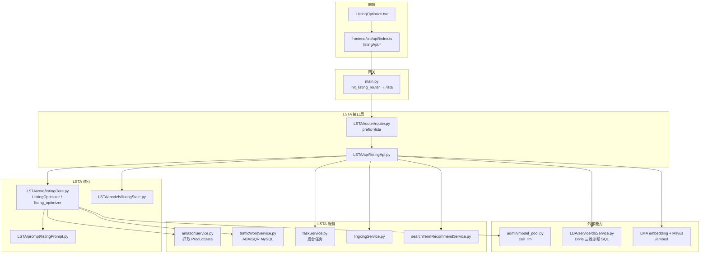
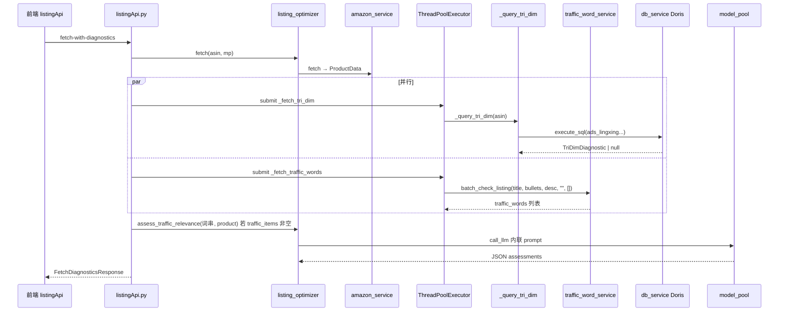
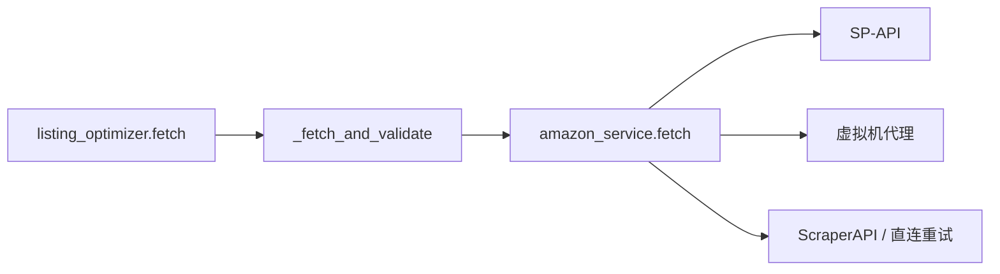
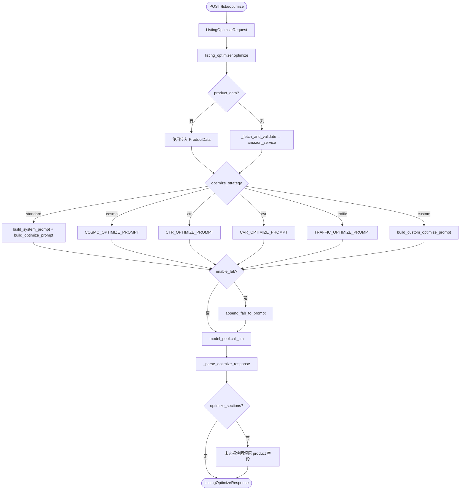
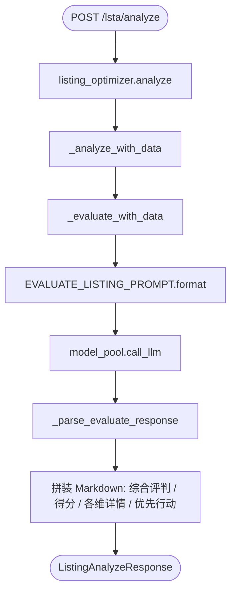
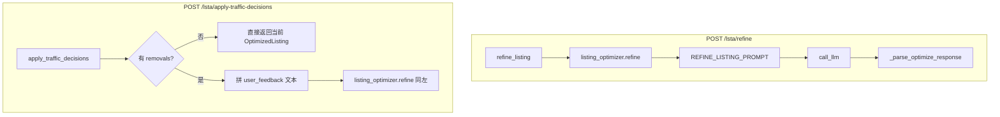
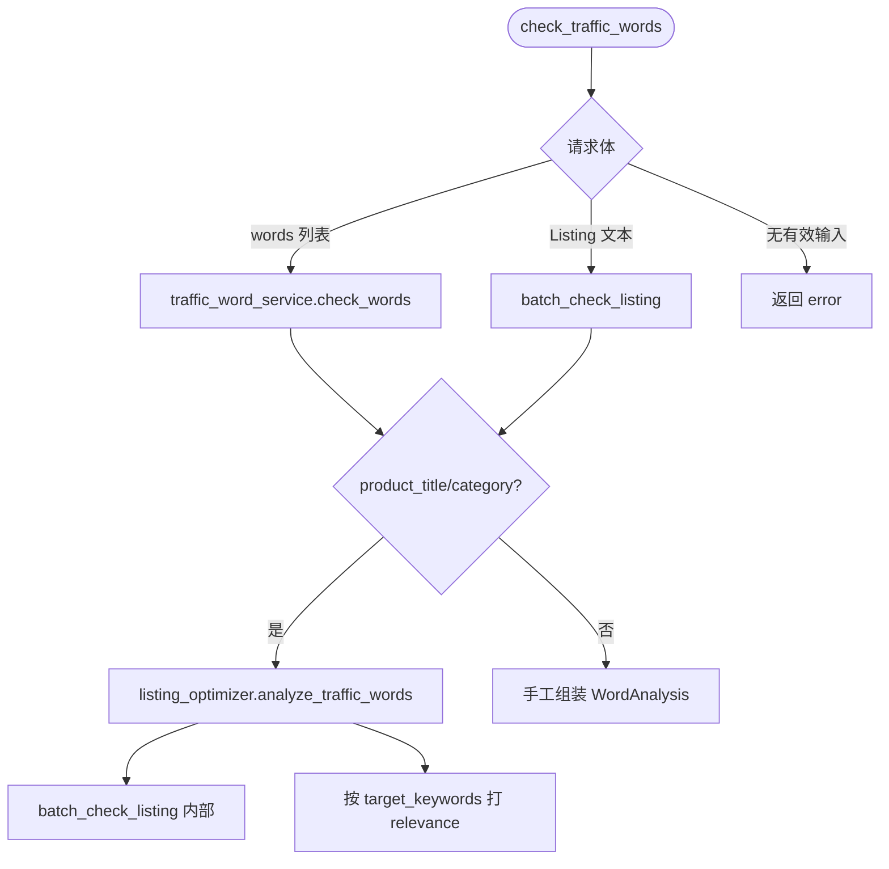
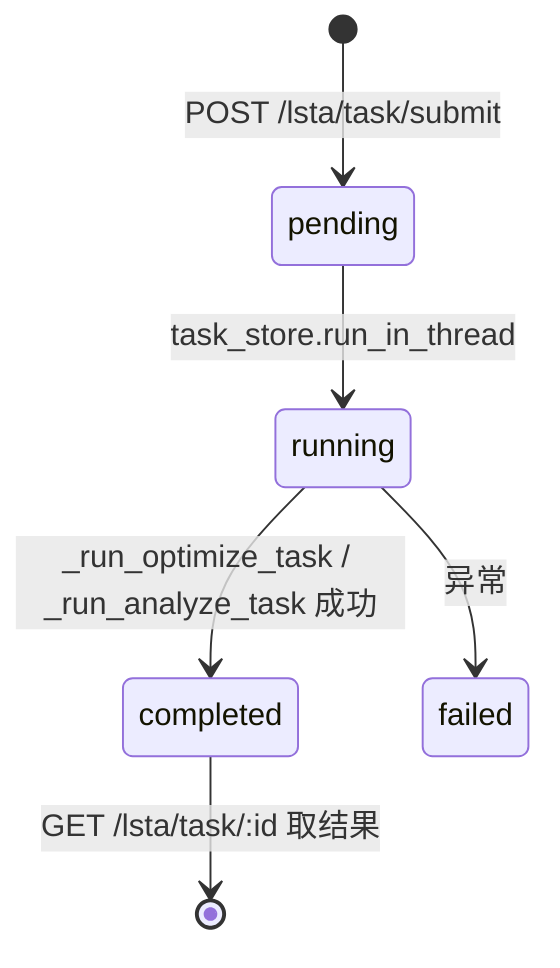
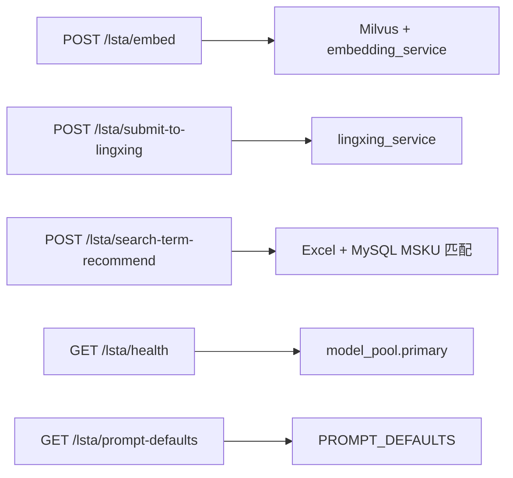

# Listing 优化 — 图形化调用结构

本文用 **Mermaid** 图描述前后端与 LSTA 模块的调用关系，便于对照代码逐项修正。

> 渲染方式：GitHub / GitLab / VS Code（Markdown 预览）/ Cursor 均可显示 Mermaid。

---

## 1. 总览：分层与依赖

---

## 2. 产品获取 + 三维诊断 + 流量词

**HTTP**：`POST /lsta/fetch-with-diagnostics`

---

## 3. Listing 优化（主路径）

**HTTP**：`POST /lsta/optimize`  
**注意**：接口层固定 `skip_traffic_analysis=True`，不在此接口内跑 `analyze_traffic_words`。

---

## 4. 四维诊断分析

**HTTP**：`POST /lsta/analyze`

**独立评判接口**：`POST /lsta/evaluate` 直接走 `_evaluate_with_data`，不拼装长 Markdown。

---

## 5. 迭代修改与流量词决策

---

## 6. 流量词检查

**HTTP**：`POST /lsta/check-traffic-words`

---

## 7. 后台任务

---

## 8. 其他接口一览（简图）

---

## 9. 关键源码锚点（便于跳转）

| 层级 | 路径 |
|------|------|
| 应用挂载 | `main.py` → `init_listing_router` |
| 路由前缀 | `LSTA/router/router.py` → `/lsta` |
| HTTP 实现 | `LSTA/api/listingApi.py` |
| 优化/诊断/精炼 | `LSTA/core/listingCore.py` |
| Prompt | `LSTA/prompt/listingPrompt.py` |
| 模型与数据模型 | `admin/model_pool.py`、`LSTA/models/listingState.py` |
| 抓取 | `LSTA/service/amazonService.py` |
| 流量词 DB | `LSTA/service/trafficWordService.py` |
| 三维诊断 SQL | `listingApi.py` 内 `_query_tri_dim` + `LDA/service/dbService.py` |
| 前端封装 | `frontend/src/api/index.ts`（`listingApi`） |
| 前端页面 | `frontend/src/pages/ListingOptimize.tsx` |

---

## 10. 图例说明

- **实线箭头**：同步调用或数据流向。  
- **sequence / state**：强调时序与任务状态。  
- **optimize_strategy**：枚举定义见 `LSTA/models/listingState.py` 中 `OptimizeStrategy`。

如需把本图与旧文档合并，可参考同目录下的 `liting优化业务流程和系统架构.md`（文件名含笔误，合并时请统一命名）。
